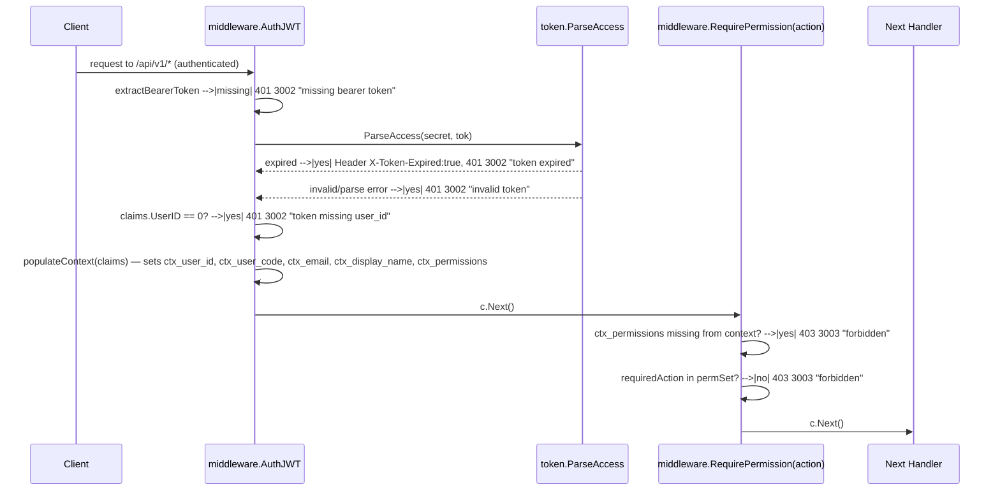

# Backend Architecture

Consolidates what was previously spread across `docs/architecture.md`, `docs/folder-structure.md`, `docs/patterns.md` (architecture-level sections only — per-module business rules live in `docs/FEATURES.md`), and the still-accurate parts of `docs/requirements.md`'s non-functional requirements. Module-specific business logic (auth, course, taxonomy, instructor, media, rbac, authorization) lives in `docs/FEATURES.md`. Schema and the permission catalog live in `docs/DATA-MODEL.md`. Reusable shared infra/utilities are catalogued in `docs/SHARED.md`.

## Overview

The **MyCourse** backend is a **Go 1.25** monolith (`module mycourse-io-be`) organized with **Domain-Driven Design (DDD)**. Each business capability is a bounded context under `internal/<domain>/`, divided into four layers with a strict dependency rule.

**Tech stack:** Gin (HTTP), GORM + PostgreSQL (persistence), Redis (cache), CloudAMQP LavinMQ (optional topic messaging), golang-jwt (auth), Brevo SMTP (email), Cloudflare R2 + BunnyCDN (storage/streaming), Uber Zap (logging), YAML + env (config).

## DDD Layer Model and Dependency Rule

Each bounded context under `internal/` follows this layer structure:

```
domain/         ← Core business entities, repository interfaces, domain errors.
                   No framework dependencies. Pure Go structs and interfaces.
                   Domain-specific constants (TTLs, limits unique to that domain)
                   also live here (e.g. internal/auth/domain/token_ttl.go).

infra/          ← Concrete implementations: GORM repositories, cloud SDK clients,
                   crypto, external API adapters. Implements domain interfaces and
                   domain ports. Persistence models (GORM row structs, JSONB
                   Valuer/Scanner) live here only — there is no separate `entity` layer.

application/    ← Use-case services (e.g. AuthService, MediaService).
                   Orchestrates domain + infra; owns business rules and workflows.
                   No HTTP types.

delivery/       ← HTTP handlers, route registration, request/response DTOs,
                   mapping from domain types to API contracts.

jobs/           ← (Optional) Background workers, schedulers, tickers,
                   orphan/cleanup enqueuers. Started from main.go, not from an
                   HTTP request. A module only adds this folder when it owns
                   long-running or scheduled work. See internal/media/jobs/
                   and internal/system/jobs/ for canonical examples.
```

**Dependency rule**, enforced by `go-arch-lint` (`make check-architecture`, config `.go-arch-lint.yml`) and `depguard` (`.golangci.yml`):

```
delivery, jobs → application → domain
infra          → domain (+ application only when infra implements an application-facing adapter — rare)
server/wire    → all layers (composition root)
```

- `domain` MUST NOT import `application`, `infra`, `delivery`, `jobs`, or framework/ORM packages (`gorm.io/gorm`, `encoding/json`, `database/sql/driver`, `gin`, `jwt`, etc. — enforced via `.golangci.yml`).
- `application` MUST NOT import `infra` or `delivery`. It depends on `domain` repository interfaces and optional `domain` ports (e.g. `MediaGateway`, `SystemCrypto`).
- `infra` implements domain repositories and ports; MUST NOT import `application`, `delivery`, or `jobs`.
- `delivery` MUST NOT import `infra`. Handlers call `application` services and, when needed, `domain` ports injected alongside the service in `wire.go` (e.g. multipart parsing on `MediaGateway`).
- `jobs` (when present) MAY import its own `application`/`domain`, and MAY import `infra` for cloud deletes; MUST NOT import `delivery`.
- Cross-domain dependencies (e.g. Auth → RBAC permissions, Taxonomy → Media profile image) use interfaces on the consuming side, adapted in `internal/server/wire.go`.
- Do not add an `internal/*/entity` package or layer.

### Domain ports (infra behind interfaces)

When `application` or `delivery` needs cloud SDKs, crypto, or multipart helpers that cannot live in `domain` entities, the pattern is a **port**: an interface declared in `domain`, implemented in `infra`, wired in `server/wire.go`.

| Port | Package | Infra adapter | Wired in |
|------|---------|---------------|----------|
| `MediaGateway` | `internal/media/domain/gateway.go` | `internal/media/infra/storage_gateway.go` | `server/wire.go` → `MediaService` + `delivery.Handler` |
| `SystemCrypto` | `internal/system/domain/ports.go` | `internal/system/infra/crypto_ports.go` | `server/wire.go` → `SystemService` |

Repository interfaces remain in `domain/repository.go`; ports cover stateless infrastructure operations that are not entity persistence.

**Worked example (auth persistence split)**, showing how one module divides a single concern across layers:

| Concern | Layer | Files |
|---------|-------|-------|
| `User`, `RefreshTokenSessionMap`, session entry types | `domain/` | `user.go` — no GORM tags, no `encoding/json` for DB |
| GORM row + column tags | `infra/` | `user_model.go` (`userRow`), `toUserDomain` / `toUserRow` |
| JSONB `Value`/`Scan` for `refresh_token_session` | `infra/` | `gormjsonb.go` |
| Repositories | `infra/` | `user_repo.go`, `user_query.go` |

## Bounded Contexts

| Context | Path | Responsibility |
|---------|------|---------------|
| **auth** | `internal/auth/` | User registration, login, email confirmation, JWT sessions, token refresh |
| **authorization** | `internal/authorization/` | Shared IAM-lite: action registry, generic grant store, resource-scoped role bindings (with a `'*'` wildcard). Course is the first registered `PolicyProvider` |
| **course** | `internal/course/` | Versioned course authoring, collaboration (via `authorization`'s role gate), review workflow, learner enrollment/progress |
| **instructor** | `internal/instructor/` | Instructor roster, applications, profiles, expertise, support tickets |
| **media** | `internal/media/` | File/video upload, R2/Bunny storage, orphan cleanup, webhooks |
| **rbac** | `internal/rbac/` | Roles, permissions, user-role/user-permission bindings |
| **taxonomy** | `internal/taxonomy/` | Course topics, outcomes, skills, tags, levels — canonical identity + localized presentation (translation tables / JSONB `translations`) |
| **system** | `internal/system/` | Privileged operations, RBAC sync, scheduler control |

Business rules for each of these (beyond what this architecture doc covers) live in `docs/FEATURES.md`. Note: there is no standalone `internal/user/`, `internal/lesson/`, or `internal/enrollment/` package — that behavior lives inside `auth` and `course` respectively (see `docs/FEATURES.md`).

## Shared Infrastructure (`internal/shared/`)

Cross-cutting concerns that are not domain-specific. Reusable utilities worth reaching for before writing something new are catalogued in `docs/SHARED.md`; this table is the structural map of the packages themselves.

| Package | Purpose |
|---------|---------|
| `db/` | GORM setup, PostgreSQL connection (`search_path` per connection via `SCHEMA_NAME_APP` / default `public`, `tunePool` on `database/sql` after open), SQL migrations |
| `cache/` | Redis client (`go-redis v9`) |
| `mq/` | LavinMQ / RabbitMQ AMQP client (`amqp091-go`): topic publish, durable queue bind, consumer registry |
| `setting/` | YAML config loading with env-var substitution |
| `logger/` | Uber Zap bootstrap, `WithRequestID`, `FromContext` |
| `token/` | JWT generation and validation |
| `middleware/` | Gin middleware: CORS, auth JWT, active-user guard, RBAC permission checks, rate limiting, circuit breaker, request logger |
| `response/` | Unified `{ code, message, data }` response envelope (`OK`, `Created`, `WriteByStatus`, `OKPaginated`, `Fail`, `AbortFail`, `Health`) |
| `validate/` | Request validation helpers, error flattening for Gin binding |
| `brevo/` | Brevo SMTP email client |
| `mailtmpl/` | HTML email templates, JS i18n loader |
| `errors/` | Shared `ErrXXX` sentinel vars and error codes |
| `constants/` | Cross-domain constants only — **5 files**: `dbschema_name.go`, `error_msg.go`, `media.go`, `permissions.go`, `mq_topics.go`, `ratelimit.go`, `register_http.go`. Domain-specific constants stay inside their own domain package |
| `utils/` | Generic utilities: `CurrentUserID`, `ParseUUIDParam`/`ParseUintParam`/path-param variants, `RoutePermission`, `EncodeWebP`, `ContentFingerprint`, `ParseBoolLoose`, `SameStringSet`, `UniqueUint`, `NilIfBlank`, `NilIfZeroUint`, `NormalizeJSON` |
| `gormx/` | Shared GORM helpers (`FirstWhere`, `CreateAndThen`, `TouchCreatedUpdated`, `ScopeActiveOnly`, `SoftDeleteWithAudit`, `RetryInSavepoint`, `IsUniqueViolation`, `DefaultConfig`, `NewSQLLogger`) |
| `timex/` | Unix epoch second helpers for audit columns (`NowUnix`, `PtrUnix`, `UnixOrZero`) |
| `cryptox/` | Shared HMAC/JWT helpers (used by auth/system infra) |
| `httpx/` | Shared HTTP handler helpers (`ListPaginated`) |
| `taxonomy/` | Taxonomy JSONB tree nodes (`translations` map) and validators (`ValidateTree`, `ValidateDescriptionParagraphs`), used by `internal/taxonomy` |
| `slug/` (+ `slug/gormslug/`) | Single owner of slug resolution (`ResolveCreate`/`ResolveUpdate`, input parsing, reserved words, random-suffix retry, GORM availability + duplicate detection) shared by course, taxonomy and users |
| `i18n/` | Content locale canonicalize / negotiate / resolve (taxonomy + chip reads; not email `mailtmpl`) |
| `httperr/` | Global Gin error middleware, panic recovery, `HTTPError` helpers |
| `parsebool/` | Loose boolean parsing for env vars and YAML flags |
| `machineidentity/` | Hybrid machine binding: enrollment file (`~/.config/mycourse/machine_identity`), OS fingerprint, canonical binding material |
| `mediaquery/` | Shared avatar/media file-ID → public URL hydration helpers, reused across bounded contexts without importing `media/domain` |
| `ratelimit/` | Fixed-window counters: `InMemoryStore` (HTTP), `FileStore` (APPCLI) |
| `resilience/` | Global circuit breaker, DB probe, optional Redis-shared state |

## Dependencies

Consolidated from `docs/dependencies.md`.

| Library | Version | Purpose |
|---------|---------|---------|
| `github.com/gin-gonic/gin` | v1.12.0 | HTTP server and router |
| `gorm.io/gorm` | v1.31.1 | ORM for PostgreSQL |
| `gorm.io/driver/postgres` | v1.6.0 | GORM PostgreSQL driver (via pgx) |
| `github.com/golang-jwt/jwt/v5` | v5.3.1 | JWT sign and validation (HS256) |
| `github.com/go-playground/validator/v10` | v10.30.1 | Request struct validation |
| `github.com/redis/go-redis/v9` | v9.18.0 | Redis client (cache for auth/me) |
| `github.com/rabbitmq/amqp091-go` | v1.10.0 | LavinMQ / RabbitMQ AMQP client (topic publish + consume) |
| `github.com/golang-migrate/migrate/v4` | v4.19.1 | SQL migration runner |
| `go.uber.org/zap` | v1.27.1 | Structured logging |
| `gopkg.in/yaml.v3` | v3.0.1 | YAML config file parsing |
| `golang.org/x/crypto` | v0.49.0 | bcrypt password hashing |
| `github.com/aws/aws-sdk-go-v2/service/s3` | latest | Cloudflare R2 (S3-compatible upload/delete) |
| `github.com/l0wl3vel/bunny-storage-go-sdk` | v1.0.0 | BunnyCDN Storage SDK |
| `github.com/h2non/bimg` | v1.1.9 | WebP encoding via libvips (CGO) |
| `golang.org/x/image` | v0.39.0 | WebP decoder for `image.DecodeConfig` |
| `github.com/supabase-community/supabase-go` | v0.0.4 | Supabase auth client |
| `github.com/joho/godotenv` | v1.5.1 | `.env` file loading |
| `github.com/google/uuid` | v1.6.0 | UUID generation (session IDs) |
| `golang.org/x/oauth2` | v0.36.0 | OAuth2 authorization-code exchange (Google popup sign-in) |
| `google.golang.org/api` | v0.287.1 | Google ID token verification (`idtoken.NewValidator`) |
| `github.com/gin-contrib/cors` | v1.7.6 | CORS middleware for Gin |
| `github.com/gin-contrib/gzip` | v1.2.5 | gzip compression middleware for Gin |
| `github.com/jmoiron/sqlx` | v1.4.0 | Extended SQL helpers (where needed beyond GORM) |
| `golang.org/x/term` | v0.42.0 | TTY detection for CLI prompts |

**Build requirements:**
- Go 1.25+.
- `CGO_ENABLED=1` plus `libvips-dev`, `libhdf5-dev`, `pkg-config` — required for WebP encoding (`bimg`) on Ubuntu 24.04+ runners (`hdf5.pc` is needed by `matio`, an optional libvips dependency). Use `make build` for CGO builds.
- `CGO_ENABLED=0` is supported for CI/review builds; WebP encoding returns HTTP 503 (stub returns `ErrImageEncodeBusy`). Use `make build-nocgo`.

No circular imports are allowed. Cross-domain dependencies (e.g. Auth calling RBAC) use interface adapters defined at the consuming domain and wired in `internal/server/wire.go` — see Composition Root below.

## Composition Root

Dependency injection lives in `internal/server/wire.go`. The `Wire()` function:

1. Instantiates infra repositories and port adapters (`mediainfra.NewStorageGateway()`, `sysinfra.NewSystemCryptoAdapter()`).
2. Constructs application services in dependency order (`wireCore`, then `Wire()` itself):
   - RBAC (no cross-domain deps)
   - System (`SystemService` + `SystemCrypto` port)
   - Media (`MediaService` + `MediaGateway` port)
   - Taxonomy (depends on Media for image validation)
   - Auth (depends on RBAC + Media)
   - Instructor (`InstructorService`, wired through adapters and shared core)
   - Authorization (`wireAuthorization`: registers `CoursePolicyProvider` and seeds its actions/role-actions — must run before Course is wired)
   - Course (`wireCourse`: receives the `Authorizer`/`RoleBindingService` constructed above)
3. Wraps cross-domain interface adapters (e.g. `rbacPermissionReader`, `mediaProfileImageValidator`).
4. Passes `MediaGateway` into `mediadelivery.NewHandler(svc, gw)` so delivery stays free of `infra` imports.
5. Returns `*Services` and `*Handlers` structs.

`main.go` calls `server.Wire(db, redis)` and passes the results to `server.InitRouter()`.

## HTTP Request Path

```
main.go
  └── setting.Setup()         — load YAML + env vars
  └── logger.InitFromSettings() — init Uber Zap global logger
  └── shareddb.Setup()        — connect PostgreSQL (GORM via gormx.DefaultConfig + SQL console logger), SET search_path (SCHEMA_NAME_APP or public), tune pool
  └── cache.SetupRedis()      — connect Redis (before APPCLI branch)
  └── mq.SetupLavinMQ()       — optional CloudAMQP LavinMQ (skipped when LAVINMQ_ENABLED=false or URL empty)
  └── resilience.ConfigureFromSettings() + StartDBProbe()
  └── appcli MaybeRun*        — optional CLI short-circuit (register / login)
  └── supabasepkg.Setup()     — Supabase HTTP client (optional)
  └── mediainfra.Setup()      — init R2/Bunny SDK
  └── maybeMigrateFromEnv()   — SQL migration mode (`MIGRATE=1` up then continue startup; `MIGRATE=2` down by file then exit)
  └── server.Wire(db, redis)  — dependency injection
  └── mediajobs.StartMediaPendingCleanupJob() — background worker
  └── mq.StartDefaultConsumers(ctx) — topic consumers (health ping + future domain topics)
  └── server.InitRouter(svcs, handlers)
        └── gin.New()
        └── middleware.RequestLogger()  — structured access log + X-Request-ID
        └── middleware.CircuitBreakerMiddleware() — circuit breaker + load tracking
        └── shared/httperr.Middleware() — centralized error handling
        └── shared/httperr.Recovery()   — panic recovery (catches unhandled panics, logs, returns HTTP 500 + app code 9998 Panic)
        └── cors.New(...)               — CORS
        └── gzip.Gzip(...)             — response compression (gin-contrib/gzip, default level)
        └── /api/system  ← privileged ops (system JWT, rate limit by IP)
        └── /api/v1 (no-filter) ← webhook callbacks (no auth)
        └── /api/v1 (standard) ← public + authenticated routes
        └── /api/internal-v1  ← RBAC admin (internal API key)
  └── router.Run(":"+port)
```

Server listens on `setting.ServerSetting.Port` (default **8080**).

### Route Groups

| Group | Middleware | Purpose |
|-------|-----------|---------|
| `/api/system` | `BeforeInterceptor`, `RateLimitSystemIP(10, 3min)`, `RequireSystemAccessToken` | Privileged operators: RBAC sync, scheduler control |
| `/api/v1` (no-filter) | none (mounts before `BeforeInterceptor`) | Webhook callbacks that bypass JWT |
| `/api/v1` unauthenticated | `BeforeInterceptor`, `RateLimitLocal(60, 1min)` | Register, login, confirm, refresh; `/catalog` (trending courses, popular instructors) shares this same tier — no separate rate-limit budget |
| `/api/v1` authenticated | `BeforeInterceptor`, `RateLimitLocal(120, 1min)`, `AuthJWT`, `RequireActiveUser` | Protected user endpoints |
| `/api/internal-v1` | `RateLimitLocal(60, 1min)`, `BeforeInterceptor`, `RequireInternalAPIKey` | Internal RBAC administration |

Exceeded limits return `HTTP 429` + app code `3006 TooManyRequests`. Per-IP overrides via `middleware.SetSystemRateLimitOverride`.

## Security

- **Route security tiers**: unauthenticated (public) → authenticated (`AuthJWT` validates Bearer token, then `RequireActiveUser` re-checks ban/disable/delete against Postgres even if the token hasn't expired) → permission-gated (`RequirePermission` checks the JWT's embedded permission set) → internal (`RequireInternalAPIKey`) → system (`RequireSystemAccessToken`).

**Request authentication & authorization middleware, step by step** (ported from the former `docs/sequence_diagrams.md` #22/#23 — these two middlewares run on every authenticated/permission-gated route and their exact failure codes aren't obvious from the route table alone):



Note: `RequirePermission` only ever checks the JWT-embedded permission set in this middleware step — the DB fallback described in `docs/FEATURES.md`'s `rbac` entry (permission check two-tier flow) happens inside `RBACService.PermissionCodesForUser`, called explicitly by handlers that need a live lookup (e.g. `GET /me/permissions`), not by this middleware itself.
- **JWT**: access tokens HS256, 15-minute TTL; refresh tokens HS256 with DB-authoritative expiry (not just the JWT `exp` field). Secret via `JWT_SECRET` env var, never hardcoded. Expired access token → `401` + `X-Token-Expired: true` header.
- **Cookies**: `access_token`, `refresh_token`, `session_id` are `HttpOnly`, `SameSite=Lax`; `Secure=true` in production (`RunMode=release`). Access JWT accepted from `Authorization: Bearer …` or the cookie; refresh/logout accept session credentials from custom headers or cookies.
- **CORS**: allowed origins via `CORS_ALLOWED_ORIGINS` (comma-separated); credentials allowed; exposes `X-Token-Expired`; allowed custom request headers `Authorization`, `X-API-Key`, `X-Refresh-Token`, `X-Session-Id`.
- **System credentials**: privileged system credentials stored as HMAC-hex derivations (`app_system_env`), never plaintext; `system_app_config.app_cli_system_password`, `app_system_env`, `app_token_env` are bcrypt hashes (cost 14) at rest, used as HMAC/JWT key material. System access tokens are short-lived JWTs signed with `app_token_env` (TTL 90 seconds), issued only via `CLI_SYSTEM_LOGIN=1` (never HTTP) and required on every `/api/system/*` route.
- **Machine identity (hybrid binding)**, used by both CLI system login and privileged registration (`internal/shared/machineidentity/`): a per-host enrollment file (random 32-byte secret, mode `0600`, at `$XDG_CONFIG_HOME/mycourse/machine_identity` or `~/.config/mycourse/machine_identity`, created on first register on that host) is combined with a live OS fingerprint (machine-id/hardware UUID, hostname, `GOOS/GOARCH`) into a canonical versioned HMAC input (`v1|file:<secret>|mid:<id>|hw:<uuid>|host:<name>|plat:<os/arch>`), then HMAC'd with `app_system_env` and stored on the privileged-user row. Copying only the DB row or only the enrollment file to another host fails login (fingerprint mismatch by design); login never creates the enrollment file (register first); changing hostname or OS machine-id requires re-registering on that host. Rotating `app_system_env` invalidates every existing `system_privileged_users` row.
- **Internal API**: every `/api/internal-v1` route requires a valid `X-API-Key`, validated by `middleware.RequireInternalAPIKey`.
- **Input validation**: all request bodies validated via Gin `ShouldBindJSON`/`ShouldBindQuery` with binding tags; failures return `400` + app code `2001 ValidationFailed`.
- **Passwords**: bcrypt at default cost; raw passwords never logged or stored.
- Public, unauthenticated-by-design GET routes are a deliberate exception, not an oversight: `GET /api/v1/catalog/courses/trending` and `GET /api/v1/catalog/instructors/popular` carry no Bearer/cookie session requirement and no auth middleware at all (`openspec/changes/add-home-catalog-apis`) — cookie/JWT auth remains the default for every other `/api/v1` route.

## Performance and Availability

- **Circuit breaker** (`internal/shared/resilience`): protects HTTP ingress and APPCLI entry. DB probe pings the primary pool; after `resilience.db_failures_to_open` consecutive failures (default 3) the circuit opens. A load probe (in-flight requests + rolling 5xx count) can also open it. Open state → `503` + app code `9018 ServiceUnavailable` (APPCLI: "service temporarily unavailable"). Half-open allows a small probe quota. Optional Redis key `mycourse:resilience:circuit` shares state across instances; degrades to in-process only when Redis is down. Configured via YAML `resilience:` block.
- **Redis caching TTLs**: `mycourse:user:me:{user_id}` (1 min, profile + permissions), `mycourse:auth:login:invalid:{normalized_email}` (1 min, negative cache), `mycourse:auth:login:user_by_email:{normalized_email}` (30s, plain user ID), `mycourse:catalog:trending_courses:limit:{n}` (5 min), `mycourse:catalog:popular_instructors:limit:{n}` (5 min). All cache helpers degrade gracefully to no-ops if Redis is unavailable.
- **Session limits**: a user cannot have more than 5 concurrent sessions; reaching the limit evicts the session with the earliest `refresh_token_expired` atomically.
- **Migrations**: `MIGRATE=1` applies pending up migrations then continues startup; `MIGRATE=2` + `MIGRATE_VERSION_FILE=<file>.down.sql` rolls back then exits. Schema changes are numbered, embedded SQL files under `migrations/`, applied via `golang-migrate`; every migration needs a companion `.down.sql` for rollback.

## Error Handling

- Domain errors not reused cross-domain live in `internal/<domain>/domain/errors.go`. Shared/cross-domain sentinel errors live in `internal/shared/errors/`. Every user-facing error has a numeric code there.
- Application and infra layers return domain errors or wrap them. **Delivery is the only layer that maps errors to HTTP status + app codes.** Never hardcode HTTP status or error codes in `application/` or `infra/`.
- Map `gorm.ErrRecordNotFound` to the shared `ErrNotFound` sentinel at the infra/repository boundary; prefer `internal/shared/gormx.FirstWhere` for repeated `Where(...).First(...)` patterns.
- **Parallel GORM reads (`errgroup`)**: when an infra repository runs concurrent read queries via `errgroup`, each goroutine must use its own GORM session — do not share one `*gorm.DB` handle (unsafe inside transactions). Course module's `parallelReadDB(db)` (`internal/course/infra/repo_helpers.go`, `db.Session(&gorm.Session{NewDB: true})`) is the canonical helper; reuse it for new parallel read paths rather than duplicating the session logic inline.

**Error code reference** (consolidated from `docs/return_types.md`; module-specific codes like `3005`/`3007` have fuller context in their `docs/FEATURES.md` entry):

| HTTP | `code` | Constant | Meaning |
|------|--------|----------|---------|
| — | 0 | `Success` | Operation completed successfully |
| 400 | 1001 | `InvalidJSON` | Request body is not valid JSON |
| 400 | 2001 | `ValidationFailed` | Request validation failed |
| 400 | 2002 | `ValidationField` | Per-field validation error |
| 413 | 2003 | `FileTooLarge` | Single uploaded file exceeds 2 GiB |
| 400 | 2004 | `ExecutableUploadRejected` | Upload extension/magic-bytes matches executable denylist |
| 413 | 2005 | — | Aggregate multipart size exceeds 2 GiB |
| 400 | 2006 | — | Too many multipart parts (max 5) |
| 400 | 2008 / 2009 | — | Batch-delete `object_keys` limit (max 10) violated |
| 400 | 3001 | `BadRequest` | Bad request (generic) |
| 401 | 3002 | `Unauthorized` | Missing or invalid JWT / system token |
| 403 | 3003 | `Forbidden` | Authenticated but lacking permission |
| 404 | 3004 | `NotFound` | Resource not found |
| 409 | 3005 | `Conflict` | Optimistic-lock version mismatch (stale `expected_row_version`) |
| 429 | 3006 | `TooManyRequests` | Rate limit exceeded |
| 409 | 3007 | `SlugConflict` | Manually supplied slug already taken; response includes `recommended_slug` |
| 400 | 4001 | `EmailAlreadyExists` | Email already registered and confirmed |
| 401 | 4002 | `InvalidCredentials` | Wrong email/password or system creds |
| 400 | 4003 | `WeakPassword` | Password fails strength requirements |
| 401 | 4004 | `EmailNotConfirmed` | Login before email confirmation |
| 403 | 4005 | `UserDisabled` | Account disabled |
| 400 | 4006 | `InvalidConfirmToken` | Stale or unknown confirmation token |
| 401 | 4007 | `InvalidSession` | Session ID unknown, UUID mismatch, or refresh rotation lost to a concurrent refresh |
| 401 | 4008 | `RefreshTokenExpired` | DB-stored refresh expiry has passed |
| 410 | 4009 | — | Registration lifetime confirmation-email cap exceeded (pending row deleted) |
| 429 | 4010 | — | Registration Redis rate-limit window exceeded |
| 502 | 4011 | — | Confirmation email send failed (Brevo) after passing rate limits |
| — | 4012 | — | Account banned (`banned_until`) |
| 400 | 4013–4017, 4019, 4023–4025 | — | OAuth sign-in errors (provider-specific; see `docs/FEATURES.md` auth entry) |
| 403 | 9017 | `ImageEncodeBusy` | WebP encode concurrency gate / CGO disabled |
| 500 | 9001 | `InternalError` | Internal server error |
| 503 | 9018 | `ServiceUnavailable` | Circuit breaker open / service degraded |
| 500 | 9998 | `Panic` | Unhandled panic (caught by recovery middleware) |
| 500 | 9999 | `Unknown` | Unknown error |

`4018 InvalidOAuthState` is **FE-local only** — never returned by BE or present in Swagger. Special header: `X-Token-Expired: true` is set only when a `401` is caused by an expired access JWT, never for missing/malformed tokens.

## API Patterns

- All JSON responses use the standard envelope via `internal/shared/response` — never raw `gin.H`. Shapes: standard `{ code, message, data }`; health `{ code, message, status }`; paginated `data` is a `PaginatedData` with `result` + `page_info`.
- Router sets `router.MaxMultipartMemory = constants.MediaMultipartParseMemoryBytes` (64 MiB) — multipart bodies larger than this spill to temp disk during parse; the per-part/aggregate size caps (see Error Handling's `2003`/`2005`/`2006`) are enforced separately in the media handler, not by this setting.
- `GET /api/v1/health` requires no authentication, returns `HTTP 200` + `{ code: 0, message: "ok", status: "ok" }`, and is used by CI/CD health probes.
- List endpoints use a `BaseFilter` struct (`page`, `per_page`, `sort_by`, `sort_order`, `search_by`, `search_data`).
- Fine-grained permission guards are applied **at the route level** using `middleware.RequirePermission`, typically through the shared route helper `internal/shared/utils.RoutePermission(...)` so delivery packages don't duplicate local permission-wrapper closures.

## LavinMQ / CloudAMQP (topic messaging)

Optional async messaging via CloudAMQP LavinMQ, using `github.com/rabbitmq/amqp091-go`.

| Concern | Location |
|---------|----------|
| Config | `config/app*.yaml` → `lavinmq:` block; env `CLOUDAMQP_URL`, `LAVINMQ_EXCHANGE` (default `amq.topic`), `LAVINMQ_ENABLED` |
| Connection bootstrap | `internal/shared/mq/setup.go` — `SetupLavinMQ()` (non-fatal when disabled or URL empty, same as Redis warn-on-fail) |
| Publish | `mq.PublishTopic(ctx, routingKey, mq.Publishing{...})` |
| Subscribe | `mq.StartConsumers(ctx, mq.Subscription{RoutingKey, Handler, ...})` — one AMQP channel per consumer |
| Built-in consumers | `mq.StartDefaultConsumers` from `main.go` (health ping topic) |
| Topic routing keys | `internal/shared/constants/mq_topics.go` |

Domain modules that need async work publish/consume via `internal/shared/mq` and add routing keys to `mq_topics.go` — do not open parallel AMQP clients in `infra/`.

## Structured Logging (Uber Zap)

- **Bootstrap**: `main.go` calls `setting.Setup()` first, then `logger.InitFromSettings()` (calls `zap.ReplaceGlobals`), then `defer logger.Sync()`. Only stdlib `log` is used before logger init.
- **Per-request fields**: `middleware.RequestLogger()` generates `X-Request-ID`, attaches it via `logger.WithRequestID`. Handlers/services log with `logger.FromContext(ctx)` for automatic `request_id` inclusion.
- Do not log HTTP bodies (PII risk). Access log includes method, path, route, status, latency, bytes, user agent, IP, `request_id`.
- **File logging**: legacy single NDJSON file via `LOG_FILE_PATH`, or dual-file mode (`LOG_FILE_ENABLED=true` + empty `LOG_FILE_PATH`) writing rotated `app.log`/`access.log`. Rotation/path keys: `LOG_DIR`, `LOG_APP_NAME`, `LOG_VENDOR`, `LOG_PATH_MODE`, `LOG_FILE_ENABLED`, `LOG_CONSOLE`, `LOG_MAX_SIZE_MB`, `LOG_MAX_BACKUPS`, `LOG_MAX_AGE_DAYS`, `LOG_COMPRESS`, `LOG_INSTANCE_ID`. Base keys: `LOG_LEVEL`, `LOG_FORMAT`, `LOG_FILE_PATH`, `LOG_SERVICE_NAME`, `LOG_ENVIRONMENT`, `APP_VERSION`, `LOG_REDIRECT_STDLOG`.
- Observability pipeline (Loki/Alloy): see `docs/observability/loki-alloy.md` + `config/alloy/be-mycourse.example.alloy`.

## Data Access Patterns

- GORM is the primary ORM; raw SQL only when required (e.g. complex RBAC joins).
- PostgreSQL table names are defined once in `internal/shared/constants/dbschema_name.go` (full table ↔ constant list: `docs/DATA-MODEL.md`'s "Code ↔ table names"); all GORM `TableName()` methods and raw SQL reference these constants — no hardcoded string literals.
- **SQL console logging**: see `docs/SHARED.md`'s "Asset: GORM SQL console logger" for the config call, latency-color thresholds, and why it's separate from the Zap `app.log`/`access.log` (`docs/observability/loki-alloy.md`).
- **Audit timestamps**: see `docs/DATA-MODEL.md`'s "Audit timestamps" section for the migration/type mapping, and `docs/SHARED.md` for the `timex`/`gormx` helper assets.
- **CRUD with soft delete** (general convention — implemented today on taxonomy's five resources and auth's `/me`; module-specific exceptions and conflict-handling details live in `docs/FEATURES.md`):
  - Active row: `deleted_at IS NULL`. Soft-deleted: `deleted_at > 0` (Unix seconds).
  - Routes: `GET /resources` (active only) vs `GET /resources/full` (includes soft-deleted); `GET /resources/:id` (404 if soft-deleted) vs `GET /resources/:id/full`; `DELETE /resources/:id` (soft) vs `DELETE /resources/:id/hard` (permanent). Register static paths (`/full`, `/:id/hard`) before generic `/:id` in Gin.
  - Infra: list uses `gormx.ScopeActiveOnly` unless the filter opts into deleted rows; GetByID defaults to active-only (keeps PATCH safe); soft delete via `gormx.SoftDeleteWithAudit`; hard delete via GORM `db.Delete`, with side effects (e.g. orphan image cleanup) only on hard delete.
  - A write that can lose a unique-index race to a concurrent request runs inside `gormx.RetryInSavepoint` and re-resolves on each attempt.

## Testing

Tests are co-located with their packages (black-box `<package>_test` or white-box `<package>`, file named `<something>_test.go` adjacent to the code under test — not centralized under a separate `tests/` root).

Run all tests: `go test ./...`.

## Linting and Quality Gate

Configuration: `.golangci.yml`, `.go-arch-lint.yml`, `Makefile`, `tools/layoutguard`.

| Check | Command | What it enforces |
|-------|---------|------------------|
| CI test gate | `make test-all` | `go test` (plain + CGO), `go vet`, `golangci-lint run`, `check-layout`, `check-architecture`, `check-dupl` |
| Full local gate | `make check-all` | `go fmt` + `test-all` + `build-nocgo` + `build` (CGO build needs libvips) |
| Format | `go fmt ./...` | Standard Go formatting (included in `check-all`) |
| Static lint | `golangci-lint run` | `dupl` (per-package, threshold 60), `gocyclo` (min complexity 15), `funlen` (60 lines / 40 statements), `depguard`, `errcheck`, `staticcheck`, `govet`, `revive`, `nolintlint`, `unused` (dead code) |
| Layer imports | `make check-architecture` | DDD boundaries (`go-arch-lint` v1.15+) |
| File placement | `make check-layout` | Go files only under allowed top-level dirs |
| Cross-package clones | `make check-dupl` | `dupl -t 60 internal` via Makefile `DUPL_THRESHOLD` (paths outside a single package) |
| Compile (no CGO) | `make build-nocgo` | CI-friendly build; WebP encode uses a stub |
| Compile (CGO) | `make build` | Production build with libvips |

`revive`: `file-length-limit` max 600 lines (comments/blanks skipped); `argument-limit` max 8 parameters (use small param structs beyond that). `funlen`: max 60 lines / 40 statements per function. `gocyclo`: complexity ≥ 15 fails. `unused`: flags dead functions/types/vars/consts, including unexported — remove or wire up, don't leave orphans. `dupl`: golangci only sees clones within one package; cross-package similarity needs `make check-dupl`.

Local gate before push: `make check-all` (full, needs libvips-dev) or `make test-all` (CI-equivalent, no compile). CI (`.github/workflows/deploy-dev.yml` `test` job) runs `make test-all`. Full CI/CD pipeline detail (build, deploy, PM2 rollback): see `docs/deploy.md`.

## Configuration

- YAML files under `config/` (`app.yaml`, `app-<STAGE>.yaml`) with values substituted from environment variables; `STAGE` selects the file.
- Key environment variables: `SUPABASE_DB_URL`, `SUPABASE_URL`, `SUPABASE_SERVICE_ROLE_KEY`, `APP_BASE_URL`, `APP_CLIENT_BASE_URL`, `CORS_ALLOWED_ORIGINS`, `CLOUDAMQP_URL`, `LAVINMQ_EXCHANGE`, `LAVINMQ_ENABLED`, `MIGRATE`, `MIGRATE_VERSION_FILE`, `CLI_REGISTER_NEW_SYSTEM_USER`, `CLI_SYSTEM_LOGIN`.
- No secrets (JWT keys, DB passwords, API keys) may be hardcoded in source code.
- PostgreSQL app schema configurable via optional env `SCHEMA_NAME_APP` (YAML `database.schema_name`); defaults to `public` and sets `search_path` on every GORM connection (see `docs/DATA-MODEL.md`).

## Background Jobs

| Job | Location | Trigger |
|-----|----------|---------|
| Media pending cleanup worker | `internal/media/jobs/` | Started in `main.go` after wiring |
| LavinMQ topic consumers | `internal/shared/mq/` | `mq.StartDefaultConsumers` in `main.go` when LavinMQ connected |
| RBAC permission sync | `internal/system/` | `/api/system/permission-sync-now` or scheduled |
| Role-permission sync | `internal/system/` | `/api/system/role-permission-sync-now` or scheduled |

## Full Directory Tree

```text
be-mycourse/
├── AGENTS.md                       # Canonical version-controlled agent instructions
├── CLAUDE.md                       # Claude entry point; imports AGENTS.md via @AGENTS.md
├── .claude/                        # Version-controlled Claude commands and agent skills
├── .context/                       # Session continuity artifacts
├── .cursor/                        # Workspace rules, editor skills
├── .github/
│   └── workflows/                  # CI/CD (deploy-dev.yml)
├── .gitnexus/                      # GitNexus graph index
├── cmd/
│   ├── syncpermissions/            # CLI: upsert permissions from constants
│   └── syncrolepermissions/        # CLI: rebuild role_permissions from constants
├── config/                         # app.yaml + app-<STAGE>.yaml
├── docs/                           # ARCHITECTURE.md, FEATURES.md, DATA-MODEL.md, SHARED.md + satellite docs (deploy, docker, observability)
├── internal/
│   ├── appcli/                     # CLI: register first system user, system login, slug backfill, legacy data import
│   ├── auth/                       # domain / application / infra / delivery (see Bounded Contexts)
│   ├── media/                      # domain / application / infra / delivery / jobs
│   ├── rbac/                       # domain / application / infra / delivery
│   ├── system/                     # domain / application / infra / delivery / jobs
│   ├── taxonomy/                   # domain / application / infra / delivery
│   ├── instructor/                 # domain / application / infra / delivery
│   ├── authorization/              # domain / application / infra / delivery
│   ├── course/                     # domain / application / infra / delivery
│   ├── shared/                     # cross-cutting packages (see Shared Infrastructure table above)
│   └── server/
│       ├── wire.go                 # Dependency injection: constructs all Services + Handlers
│       └── router.go               # Gin router setup, route group mounting
├── migrations/                     # Versioned SQL migration files (embedded)
├── template/
│   ├── html/email/                 # HTML email shells (confirm_account.html)
│   └── languages/confirm_account/  # Per-locale JS i18n maps (en.js, vi.js)
├── pkg/
│   └── supabase/                   # Supabase HTTP client + DB helpers (optional integration)
├── scripts/                        # Deploy helpers: pm2-reload…, docker/*.sh + *.ps1 + *.cmd (Windows)
├── docker/                         # compose.*.yml + stack.*.yml (optional container deploy)
├── Dockerfile                      # Multi-stage CGO image (see docs/docker.md)
├── .dockerignore
├── go.mod
├── go.sum
└── main.go                         # Process entry point
```

### Per-module layer contents

| Context | `domain/` | `application/` | `infra/` | `delivery/` |
|---------|-----------|-----------------|----------|-------------|
| `auth` | Pure `User` (no GORM), `RefreshTokenSessionMap`, repo interfaces, errors, token TTLs | `AuthService`: register, login, confirm, refresh, GetMe, UpdateMe, DeleteMe; `cache_keys.go`, `email_limits.go` | `userRow` + mappers, `gormjsonb.go`, `user_repo.go`, `user_query.go`, bcrypt `crypto.go`, `session_limits.go` | `Handler`, `routes.go`, DTOs, mapping |
| `media` | `File`, `MediaGateway` port, repo interfaces, Bunny status/webhook/meta types; `errors.go` (`ProviderError` only) | `MediaService` (injected `MediaGateway`), `service_upload_helpers.go` | `storage_gateway.go`, `repos.go`, `provider_runtime.go`, `provider_r2.go`, `provider_bunny.go`, `provider_local.go`, `media_classification.go`, `media_entity_metadata.go`, `multipart.go` | `Handler` + `MediaGateway`; `FileFilterRequest` embeds `utils.BaseFilter`; multipart bind in `mapping.go` |
| `rbac` | `Permission`, `Role` entities | `RBACService`: permission/role CRUD, user-role/direct-permission bindings | GORM repos, `sql_templates.go` | `handler.go`, `handler_helpers.go`, `handler_mutations.go` — under `/api/internal-v1/rbac` |
| `taxonomy` | Entities and repo interfaces | `TaxonomyService`, `service_helpers.go` (shared create/update/delete) | `repos.go`, `repos_crud_helper.go`, `jsonb_types.go` | `handler.go`, `handler_helpers.go`, `routes.go` |
| `instructor` | Applications, profiles, expertise, tickets; repo interface | `InstructorService` + roster/apps/profiles/expertise/tickets; ports for RBAC, auth cache, media | `GormRepository`, rows, profile JSONB | Split handlers (`handler_expertise_*`, `handler_ticket`, …), `routes.go`; list handlers use `httpx.ListPaginated` directly |
| `system` | `SystemCrypto` port, repo interfaces | `SystemService`: permission sync, role-permission sync, scheduler control, system login | GORM repos, `crypto.go` + `crypto_ports.go` | `Handler`, `routes.go` — under `/api/system` |

Instructor wiring: `internal/server/wire_instructor.go`, `wire_instructor_adapters.go`, `wire_core.go`, `router.go` (`instdelivery.RegisterRoutes`).

`internal/appcli/`: CLI flows for system administration — register privileged user (`CLI_REGISTER_NEW_SYSTEM_USER=1`), obtain system JWT (`CLI_SYSTEM_LOGIN=1`), backfill missing user slugs (`CLI_BACKFILL_USER_SLUGS=1`), and restore legacy SQL dumps into the UUID-v7 schema (`CLI_IMPORT_LEGACY_DATA=1` + `CLI_IMPORT_LEGACY_DATA_DUMP=/absolute/path/backup-*.sql`, remapping numeric ids → UUID v7, ULID `user_code`, writing `*.idmap.json` beside the dump). `cli_guard.go` enforces circuit breaker + file-backed rate limit (5 ops / 3 min) before credential prompts.

`cmd/`: `cmd/syncpermissions/` upserts `permissions` rows from `constants.AllPermissions`; `cmd/syncrolepermissions/` rebuilds `role_permissions` from `constants.RolePermissions`.

## Related Documentation

| Document | Contents |
|----------|----------|
| [`README.md`](../README.md) | Quick start, CORS, response format, error codes |
| [`docs/FEATURES.md`](FEATURES.md) | Per-module business rules, flows, API surface |
| [`docs/DATA-MODEL.md`](DATA-MODEL.md) | Schema overview + permission catalog |
| [`docs/SHARED.md`](SHARED.md) | Reusable shared infra/utilities catalogue |
| [`docs/deploy.md`](deploy.md) | Local dev, CI/CD, VPS deploy, PM2 rollback |
| [`docs/docker.md`](docker.md) | Docker build/compose alternative |
| [`docs/observability/loki-alloy.md`](observability/loki-alloy.md) | Loki/Alloy log shipping |
