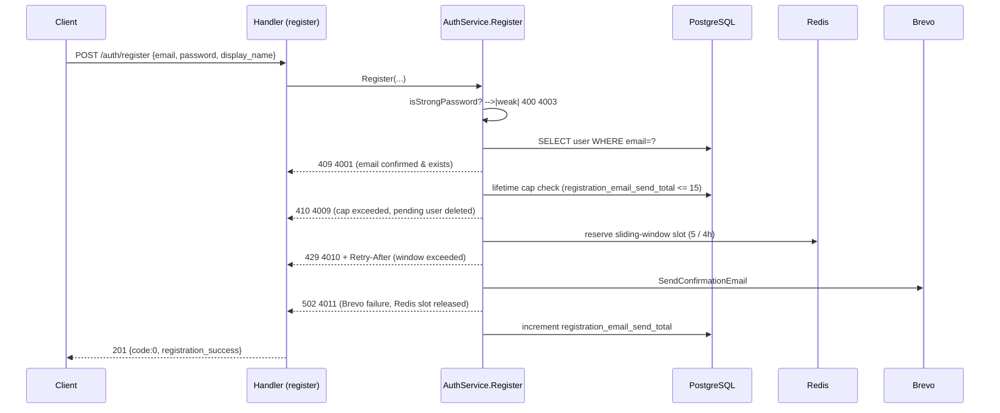
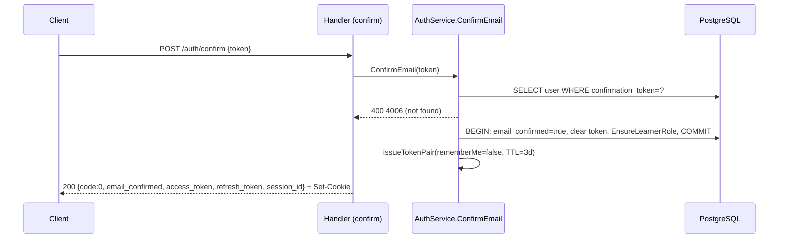
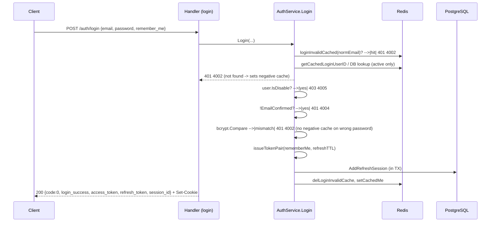

# Features

Module-level reference for `be-mycourse`. One entry per bounded context (not per micro-feature) — this codebase's domains are tightly coupled (e.g. course review touches Course + Authorization + Instructor in one flow), so splitting by narrow feature would force the same cross-cutting rule to be repeated across entries. Entry length follows actual complexity, not a fixed budget: `rbac` is short because its rules are short; `instructor` and `taxonomy` are long because their rules are genuinely non-obvious and code can't say them for itself.

Grep hint: `grep -n "^## " docs/FEATURES.md` to jump between entries.

Schema detail (columns, FKs, indexes) lives in `docs/DATA-MODEL.md`, not here — each entry's `DB:` line only names the tables it touches.

---

## auth

**Keywords:** login, register, OAuth, Google, X, Discord, JWT, session, refresh token, `/me`, profile, user slug, password

**Purpose:** Authenticates users via stateful JWT sessions (access + refresh + session_id, all HttpOnly cookies and JSON body) and owns the authenticated user's own profile (`/me`). There is no separate `internal/user/` package — profile/permission self-service lives here (`internal/auth/`), not in a `user` module.

**Rules:**
- Three tokens per login: `access_token` (15 min), `refresh_token` (3d standard / 30d remember-me), `session_id` (same TTL as refresh). All protected endpoints require `Authorization: Bearer <access_token>` — **cookies are not read by the auth middleware**, only by the browser for transport.
- `RequireActiveUser` rejects soft-deleted (404), disabled (403/`4005`), and banned (403/`4012`) accounts on every authenticated request — a still-valid JWT cannot bypass a ban or disable.
- `password_set_at` (not `hash_password`'s presence) is the single source of truth for "has a usable local password" — OAuth-only users get a bcrypt hash of a random secret, so a non-null hash never implies a real password. `Login` rejects OAuth-only users with `4002` until a password is set.
- Login negative-caching is asymmetric: unknown/soft-deleted email populates a 1-minute negative cache; wrong password never does; disabled/banned/unconfirmed return before bcrypt ever runs (bcrypt only runs when active + accessible + confirmed).
- Max 5 concurrent sessions/user; 6th login evicts the session with the earliest expiry inside one DB transaction. Session rotation updates in place — does not grow the count.
- OAuth merge policy differs by provider (`ProviderPolicy`): Google/Discord require verified email and auto-confirm new users; X never auto-merges an existing email (`4019`, link required) and new X users stay unconfirmed. Identity resolution is `FindByProviderSub` first, then `FindByEmail` — `provider_sub` wins on conflict, with up to 3 retries on a unique-constraint race before `4015`. Missing-email/unverified-email failures are provider-specific codes, not shared: X with no email → `4017`; Discord with no email → `4025`; Discord with an unverified email → `4024`.
- `/me` reads are Redis cache-first (≤1 min staleness) with a legacy self-heal: a confirmed user with zero effective permissions gets `EnsureLearnerRole` re-run and the stale cached `permissions: []` payload bypassed.
- **User slug**: generated from `display_name` on create (gosimple transliteration; fallback `user-{7 chars}`), never auto-follows later `display_name` changes, changed only via `PATCH /me`. Collisions/reserved words/former-own-slugs auto-suffix (never a 409); a slug a user leaves is reserved in `user_slug_history` so another user can't claim it. Reserved words (`admin`, `me`, `api`, …) rejected with 400 before any write.
- **CSRF**: double-submit cookie pattern — cookie `csrf_token`, request header `X-CSRF-Token`, bootstrap endpoint `GET /api/v1/auth/csrf`. Unsafe methods (`POST/PUT/PATCH/DELETE`) must present a header matching the cookie. Rollout note: middleware enforcement may be toggled off at the router while the full CSRF logic and endpoint stay in place for later re-enable — absence of a 403 on a missing/mismatched token does not mean the logic was removed, check the router wiring before assuming it's inactive.
- `/me`'s `roles` field is **display-only and never authoritative for authorization** — it's a raw role-name array (fixed order: `sysadmin`, `admin`, `instructor`, `learner`, unknowns after) returned alongside `permissions`; only `permissions` (the RBAC union) gates access. `PATCH /me` accepts an optional `avatar_file_id` (must reference an existing `media_files` row that is kind `FILE`, status `READY`, and an image MIME/extension — never an arbitrary client-supplied URL); empty string clears it. `DELETE /me` soft-deletes; `DELETE /me/hard` hard-deletes; both schedule avatar orphan cleanup when `avatar_file_id` is set. There is no `GET /me/full`.

**API:** `POST /api/v1/auth/{register,login,confirm,refresh,logout}`, `POST /api/v1/auth/{google,google/onetap,google/mobile,x,discord}`, `GET/PATCH/DELETE /api/v1/me`, `DELETE /api/v1/me/hard`, `GET /api/v1/me/permissions`.

**Flow:** Register → Brevo confirmation email (rate-limited: 15 lifetime sends / 5 per 4h Redis window) → Confirm (sets `email_confirmed`, assigns `learner` role, issues tokens — all in one transaction) → Login (negative-cache + accessibility + bcrypt gates, in that order) → Refresh (rotates pair, `session_id` unchanged) → Logout (idempotent, revokes session server-side). Detailed step-by-step diagrams below (ported from the former `docs/sequence_diagrams.md`, the only place these exact error-code branches were previously drawn).

<details>
<summary>Detailed flow diagrams (register, confirm, login, refresh, logout)</summary>







```mermaid
sequenceDiagram
    participant C as Client
    participant H as Handler (refresh)
    participant SVC as AuthService.RefreshSession
    participant DB as PostgreSQL

    C->>H: POST /auth/refresh  X-Refresh-Token + X-Session-Id
    H->>H: headers missing? -->|yes| 400 3001
    H->>SVC: RefreshSession(sessionStr, refreshTokenStr)
    SVC->>SVC: ParseRefreshIgnoreExpiry -->|malformed| 401 4007
    SVC->>DB: SELECT user BY refreshClaims.UserID -->|not found| 401 4007
    SVC->>SVC: user.IsDisable? -->|yes| 403 4005
    SVC->>SVC: lookup session[sessionStr] -->|missing or uuid mismatch| 401 4007
    SVC->>SVC: now > entry.RefreshTokenExpired? -->|yes| 401 4008
    SVC->>SVC: new TTL (rememberMe -> 30d else remaining lifetime); rotate access+refresh (new UUID)
    SVC->>DB: SaveRefreshSession (jsonb_set in-place, session_id unchanged)
    H-->>C: 200 {code:0, token_refreshed, access_token, refresh_token, session_id}
```

```mermaid
sequenceDiagram
    participant C as Client
    participant H as Handler (logout)
    participant SVC as AuthService.Logout
    participant DB as PostgreSQL

    C->>H: POST /auth/logout  X-Refresh-Token + X-Session-Id
    H->>H: headers missing? -->|yes| clearAuthCookies, 400 3001
    H->>SVC: Logout(sessionStr, refreshTokenStr)
    SVC->>DB: LoadSessions(userID)
    alt session key missing
        SVC-->>H: nil (idempotent)
    else uuid mismatch
        SVC-->>H: ErrInvalidSession
    else valid
        SVC->>DB: RemoveSession; delCachedMe
    end
    H->>H: clearAuthCookies (always)
    H-->>C: 401 4007 (invalid session) or 200 logout_success
```

</details>

**DB:** `users`, `user_oauth_identities`, `user_slug_history`. Session state lives in `users.refresh_token_session` (JSONB).

**Gotcha:** `4018 InvalidOAuthState` is FE-local only (state/cookie mismatch) — it never appears in a BE response or Swagger. X and Discord both skip Go-side `state` validation entirely (handled in FE server action). `POST /auth/register` rate limits respond with both a generic `Retry-After` header and an app-specific `X-Mycourse-Register-Retry-After` header (seconds) on `429`/code `4010`; exceeding the lifetime send cap (15) returns `410`/`4009` (pending row deleted — user must re-register from scratch, not just resend); a Brevo send failure after limits pass returns `502`/`4011`. `/auth/google*`, `/auth/x`, `/auth/discord` each register their route only when that provider's env vars are configured — a missing route for one of these in a given environment is expected, not a bug.

---

## course

**Keywords:** course, version, draft, publish, review, outline, section, lesson, sub-lesson, collaborator, enrollment, progress, learner, trending, catalog

**Purpose:** Owns course authoring (versioned draft/review/publish cycle), the outline tree (sections → lessons → sub-lessons), collaborator membership, and learner-facing enrollment/progress. There is no standalone `internal/lesson/` or `internal/enrollment/` package — both live inside `internal/course/`, tightly coupled to version selection and stable-content progress migration.

**Rules:**
- `course_versions` has exactly one active `DRAFT` per course. Learners always read `current_published_version_id`; instructor edits always write to the draft, never the published row. `version_no` is monotonic per course; reject/reopen always fork a **new** draft at `max+1` (never flip status on the rejected row in place).
- Collaborator roles are **not** a Course-owned table — they're resource-scoped role bindings in `internal/authorization` (`resource_type = "course"`). `OWNER` is synthesized directly from `courses.owner_user_id` at decision time (never a stored binding); `EDITOR` is an active role binding. Every access check funnels through one seam, `requireCourseAction` → `Authorizer.Authorize` — nothing in `internal/course` compares a role name string directly.
- Optimistic lock: `row_version` starts at 1 (GORM must set it explicitly — zero-value insert would let the column `DEFAULT 1` silently apply, hiding a real bug). `PATCH /basic-info` requires `expected_row_version >= 1`; stale → `ErrCourseOptimisticLock`.
- Slug is independent of `title` since `rework-course-slug-management`: on create, a manual slug is validated/used-if-free or rejected with `409 SlugConflict` + `recommended_slug`; omitted auto-generates from `title`. On `PATCH /basic-info`, slug is a separate PATCH-omittable field — a collision auto-resolves with a random suffix, no confirmation step, never a 409.
- Outline reorder is two bulk `CASE stable_id` UPDATEs (temp negative indices, then `0..n-1`), not one UPDATE per row — partial reorders must never violate the active-rows unique index. Parent-row deletes must use `Where("id = ?", rowID).Delete(model)` — GORM treats a bare UUID string passed to `Delete(model, rowID)` as raw SQL and Postgres rejects it.
- `submit-review` runs `validateDraftForReview` inside the same transaction as the status flip to `IN_REVIEW` — at least 1 section/lesson/sub-lesson each, every `VIDEO` sub-lesson must reference a `READY` media file, every collaborator must be an active instructor, at least 1 collaborator required.
- `draft/prepare`, `submit-review`, and `reopen-draft` are **canonical-owner-only** (`requireOwnerAccess` → `ErrCourseOwnerOnly`, HTTP 403) — an `EDITOR` collaborator can edit outline/basic-info on an existing draft but cannot prepare a new draft, submit it for review, or reopen a rejected one. Don't confuse this with the separate "collaborator bulk-add is owner-only" rule below; this gate applies to draft lifecycle transitions themselves.
- Collaborator bulk-add is **canonical-owner-only**, batches the role-binding assignment in one call (never one call per principal), and treats an already-active collaborator as a no-op success. The owner can never appear in `failed[]` or be modified by this path.
- Approve/reject by a non-collaborator admin loads the response via `loadCourseDetailForReviewer` (no collaborator gate) so the decision-making admin gets `200` instead of `403` right after committing the decision.
- Learner enrollment/progress: `course_progress_items` keys progress by `stable_content_id`, not version-local row ids, so progress survives a version swap for content that kept the same stable id. `GET /learner-courses/continue` orders by most-recent interaction, falling back to enrollment `created_at` when nothing started yet, and counts completed/total across **all** sub-lesson kinds (not video-only).

**API:** `POST/GET/PATCH/DELETE /api/v1/courses{,/{courseId}}`, `/api/v1/courses/{courseId}/{basic-info,draft/prepare,submit-review,reopen-draft}`, `/api/v1/courses/{courseId}/{sections,lessons,sub-lessons}*` (CRUD + reorder), `/api/v1/courses/{courseId}/collaborators*`, `/api/v1/courses/{courseId}/leases/*`, `/api/v1/course-reviews/{pending,{courseId}/approve,{courseId}/reject}`, `/api/v1/course-admin/courses*` (catalog/trash), `/api/v1/learner-courses*` (incl. `/continue`), `/api/v1/catalog/courses/trending` (public, no auth).

**Flow:** Create (1 transaction: insert course + v1 draft + set draft pointer) → edit outline/basic-info on draft → submit-review (validated, same transaction) → admin approve (sets published pointer, clears draft) or reject (freezes rejected version, forks new draft at `max+1`) → learner reads published version only.

**DB:** `courses`, `course_versions`, `course_sections`, `course_lessons`, `course_sub_lessons` (+ `_videos`/`_texts`/`_quizzes`/`_quiz_options`), `course_edit_leases`, `course_enrollments`, `course_progress_items`. Collaborator membership lives in `authorization_role_bindings`/`authorization_role_actions`, not a course table (`course_collaborators` was dropped).

**Gotcha:** The public `GET /catalog/courses/trending` route carries **no auth middleware at all** — distinct from `learner-courses*`, which stays authenticated (`course:read`) by design. Don't accidentally reuse the authenticated DTO shape for the public projection. All 3 home-catalog endpoints (`catalog/courses/trending`, `catalog/instructors/popular`, `learner-courses/continue`) accept an optional `limit` with a documented default/max: 8/24, 4/12, 4/10 respectively. `CourseListItem.owner_display_name`/`owner_slug` are populated **only** on `GET /course-admin/courses`, `GET /course-admin/courses/trash`, and `GET /course-reviews/pending` (both `omitempty`) — the instructor's own `GET /courses/my` and the learner catalog omit them; don't assume every `CourseListItem`-shaped response carries owner identity. `TrendingCourseItem`/`ContinueLearningItem` are deliberately **separate structs**, not an extension of `CourseListItem` — this is intentional so public/home-feed fields never leak into the authenticated admin/instructor response shape; don't "simplify" by merging them.

---

## taxonomy

**Keywords:** taxonomy, topic, outcome, skill, level, tag, locale, translation, multilingual, slug, optimistic lock, 3005, 3007

**Purpose:** Classification reference data for courses (topics, outcomes, skills, levels, tags) with a hybrid multilingual model: canonical fields on the root row plus a `*_translations` table (and, for tree nodes, an inline JSONB `translations` map).

**Rules:**
- **Canonical ↔ `en` write-sync**: if both the canonical field and `translations.en` are present in one write and **differ**, reject (4xx) — no silent preference. If only one is present, mirror it to the other. After every successful write, canonical text must equal the `en` translation text (invariant, asserted in tests). Writing a non-`en` locale touches only that locale's translation row, never canonical.
- **Slug is independent of name** (since `unify-taxonomy-slug-management`): an update that omits `slug` leaves it unchanged **even when `name`/`en` changes**. Manual slug validated-and-used-if-free, or auto-resolved with a random suffix on collision (never a confirmation step on update; `409`/`SlugConflict`/code `3007` + `recommended_slug` only on **create** with a taken manual value). Auto-generation from canonical `name` only happens on create with no manual slug supplied.
- **Locale write vs read are separate code paths on purpose** — never share one "normalize then fallback" function. Write: canonicalize BCP47 (lowercase language, uppercase region, titlecase script; never strip region), reject length >16 chars, reject empty/invalid (no remap to `en`), and reject (4xx) if two raw locale keys in the same payload canonicalize to the same locale with **different** payloads (identical payloads may silently collapse). Read: negotiate `exact locale → base language → en → canonical`, defaulting silently to `en` on missing/invalid query (never a 4xx on read).
- Outcome locale resolution picks one whole translation row (exact → base → en → canonical) — `short_description` and `description[]` must come from the **same** resolved locale; never mix `resolved_locale=vi` display text with `en` description array.
- Optimistic lock: `row_version` on each of the 5 root tables; stale write → **HTTP 409 / app code 3005**. Tree-node slug collisions are scoped **within one tree** (one JSONB blob), not globally across rows — a manual node slug colliding with a sibling auto-resolves with a random suffix.
- Tree limits: max depth 12, max 100 nodes. On outcome translation updates, the submitted `translations` map **replaces** the full set of locales — keys missing from the payload are deleted in the same transaction, not merged.
- Per-locale content limits apply to **every** locale, not just canonical: node name 1–255 runes; outcome `short_description` 1–100 + description max 8×120-char paragraphs. A description present without a short_description is still 4xx even if otherwise empty-droppable.
- No hard language whitelist for storage (any valid BCP47 ≤16 chars is accepted) — only the FE admin add-locale UI restricts to a preset dropdown.

**API:** `GET/POST/PATCH/DELETE /api/v1/taxonomy/{topics,outcomes,skills,levels,tags}` (+ `/full`, `/{id}/hard`), all requiring `Authorization: Bearer`.

**Flow — slug conflict on create (409 / 3007):**
```
Client → POST /taxonomy/topics {name, slug: "python"}
Server → slug "python" already taken by another active row
       → 409 { code: 3007, message: "slug_conflict", data: { recommended_slug: "python-x7k2p9q" } }
Client → retry with recommended_slug or a different manual value
```

**Flow — optimistic lock conflict (409 / 3005):**
```
Client A → GET topic (row_version = 3)
Client B → PATCH topic {expected_row_version: 3} → succeeds, row_version → 4
Client A → PATCH topic {expected_row_version: 3} (stale)
Server   → 409 { code: 3005, message: "conflict" }
Client A → re-GET, re-apply edits on row_version = 4, retry
```

**DB:** `course_topics` (+`_translations`), `course_outcomes` (+`_translations`), `course_skills` (+`_translations`), `course_levels` (+`_translations`), `tags` (+`_translations`). Tree nodes (`child_topics`/`children`) are inline JSONB, not separate tables.

**Gotcha:** Instructor expertise/application taxonomy chips thread `locale` all the way from delivery → service → repository using the *same* fallback chain as taxonomy reads — a mutation response (approve/reject/submit) that hard-codes `locale=""` instead of forwarding the client's `locale` is a regression, not a stylistic choice.

---

## instructor

**Keywords:** instructor, application, roster, approve, reject, resubmit, SLA, state machine, bio, certificate, expertise, ticket, P68, submit_blocked

**Purpose:** Manages the instructor roster, the become-an-instructor application lifecycle (submit → review → approve/reject/return → resubmit), managed instructor profiles, expertise (topic/skill junctions), and support tickets. Uses **additive RBAC** — granting `instructor` never removes `learner`.

**Rules:**
- **Application state resolver (A–H), canonical priority order — BE and FE must match exactly:**
  1. Not authenticated → **A**
  2. `review_status === "approved"` → **G** (checked *before* P68)
  3. `rejection_count >= 5` → **H**
  4. Effective `instructor_application:submit_blocked` (P68) → **B**
  5. No application / eligible first submit → **C**
  6. `pending` within SLA → **D**
  7. `returned` → **E**
  8. `rejected`, `rejection_count < 5` → **F**

  **State G must win over State B.** A just-approved user still holds P68 (granted with the `instructor` role), but the resolver must show "approved" (G), not "cannot submit" (B) — checking P68 before `review_status` is a bug, not a simplification.
- **SLA**: 5 days from `submitted_at`/`review_due_at`. A `pending` row past due auto-transitions to `returned` (data preserved, **does not** increment `rejection_count`) — distinct from an admin `reject`, which does increment it.
- **`bio` field**: Quill Delta JSON, structural allow-list validated on **every** write path (submit, resubmit, profile upsert) — only `bold/italic/underline/strike/list` ops allowed; media embeds, `font`, `size`, `header`, or any unknown attribute → rejected. Raw value >32KB rejected. Length is **100–2000 Unicode code points on extracted plain text**, counted including whitespace — not UTF-8 byte length, not non-whitespace count. FE and BE must agree on "is this Delta JSON or legacy plain text" using the identical rule (JSON with an `ops` array = Delta; anything else = legacy plain text), or the two sides will validate different things.
- **Certificate dedup**: two persisted rows are duplicates if they share a non-empty `certificate_file_id`, a non-empty trimmed `credential_url`, **or** the same normalized `title|issuer|issued_year` composite (case-insensitive, whitespace-runs collapsed). Enforced on **both** application submit/resubmit and admin profile upsert — a rule that only lived on one write path would be a gap, not a simplification.
- **Approve ordering is a deliberate safety invariant, not an implementation detail**: step 1 (one DB transaction: copy profile snapshot + expertise junctions, set `review_status=approved`) must commit *before* step 2 (`AssignRole(instructor)`). If step 2 fails after step 1 succeeds, the application is already approved without the role — this is considered **safer** than the reverse order, because an admin can idempotently retry approve, whereas granting the role before the application state is final would leave a role grant with no corresponding "approved" record if the DB write then failed.
- Admin application lists **never** return `approved` rows (`status=approved` query → HTTP 400) — approved instructors move to `GET /instructor-profiles` instead. Sort tier: eligible users (#2 not-disabled/banned + #3 email-confirmed) always sort before ineligible ones, recency tiebreak within each tier.
- Eligibility gates (#2 not-disabled/not-banned, #3 email-confirmed) apply to **assignment actions** (roster add, approve, reject) but **not** to admin audit list visibility — disabled/banned/unconfirmed applicants still show up on the list so admins can see them, they just can't be approved/added without passing the gate first.

**API:** `GET/POST/PUT/DELETE /api/v1/instructor-applications{,/me,/{id},/{id}/approve,/{id}/reject,/contact-admin}`, `/api/v1/instructor-profiles{,/me,/{id}}`, `/api/v1/instructors{,/bulk,/roster-candidates,/{id}}`, `/api/v1/instructors/{id}/expertise/{topics,skills}*`, `/api/v1/instructor-tickets{,/{id}/close,/{id}/messages}`, `/api/v1/catalog/instructors/popular` (public).

**Flow:** First submit (`POST`, state C→D) → admin approve/reject or SLA-return → resubmit (`PUT /me`, from `returned` unlimited or from `rejected` while `rejection_count<5`) → on approve: snapshot copy + role grant (ordering invariant above) → State H (5 rejections) routes to a contact-admin ticket instead of resubmit.

**DB:** `instructor_applications`, `instructor_application_topics`, `instructor_application_skills`, `instructor_profiles`, `instructor_expertise_topics`, `instructor_expertise_skills`, `instructor_tickets`, `instructor_ticket_messages`.

**Gotcha:** `teaching_content_ideas` uses the *same* Unicode-code-point counting unit as `bio` (50–500) but is plain `Textarea`, not Delta JSON — don't apply the Delta allow-list validator to it.

---

## media

**Keywords:** upload, media, file, video, image, R2, Bunny, webhook, MIME, visibility, ownership, orphan cleanup

**Purpose:** Unified upload/storage API across three providers — Cloudflare R2 (non-video files), BunnyCDN Stream (video), and a local signed-URL fallback. Provider selection is server-side only, never client-supplied.

**Rules:**
- **MIME is never trusted from the client.** Routing (kind, provider, WebP-encode decision, executable check) uses `detectTrustedMIME` (magic-number detection on bytes), falling back to filename extension only when detection is empty/blocked. A *second*, later layer (`applyStorageMIMEPolicy`) decides the final stored/CDN `Content-Type` after encoding — e.g. a successfully-WebP-encoded image is forced to `image/webp`; anything that fails a content/extension consistency check (HTML bytes with a `.pdf` extension, OOXML zip mismatch, non-`video/*` for a video kind) is forced to `application/octet-stream`, never trusted as-is.
- All image uploads are **synchronously** re-encoded to WebP server-side before provider upload (bounded concurrency, semaphore cap 4) — this isn't optional or client-controlled.
- Executable denylist (extension + magic bytes: PE/MZ, ELF, Mach-O, shebang) applies only to non-image, non-video uploads.
- **Ownership/visibility** (migration `000030`): every new upload gets `user_id` from JWT (never client body) and `visibility` defaulting to `private`. List returns only the caller's own files + public files; rows with `user_id IS NULL` (legacy, pre-backfill) are excluded from list entirely until backfill completes. Update/delete on a legacy NULL-owner row is denied even though read may still succeed via a known `object_key`.
- `GET /media/files/:id` has **no URL-synthesis fallback** — if the DB row is missing or soft-deleted, it's a hard not-found, specifically so row-level access can't be bypassed by guessing a storage/CDN key.
- Bunny webhook field merge is **additive**, never destructive: a webhook never overwrites valid prior data with a zero value. The underlying repo write is an explicit `Updates(map[string]any{...})` listing every column by name — a prior bug used GORM's `Assign+FirstOrCreate`, which silently skipped zero-value fields in the generated UPDATE, so a real `duration=190` from Bunny could compute correctly in Go but never reach the DB column.
- Video duration resolves from `media_files.duration` at **read time only** — Course never calls Bunny directly. A delayed one-shot backfill job (~2 min after process start) fixes rows still showing 0 after encoding finished.
- Orphan cleanup is enqueued on replace or parent-row delete, processed asynchronously with retry/backoff; after max attempts the row is marked `FAILED` permanently (not retried forever).
- A single uploaded file over **2 GiB** (`2×1024×1024×1024` bytes) is rejected at both handler and service layers with HTTP **413** + app code **2003** (`FileTooLarge`); the byte cap and its one shared message constant live in `constants/error_msg.go` and must stay the single source for `pkg/errcode`'s default message and `pkg/errors.ErrFileExceedsMaxUploadSize` — no duplicate literal. Reverse proxies/load balancers in front of the API must be configured with a body limit at least this large or requests get dropped before reaching the app.
- Upload (`POST`/`PUT /media/files{,/:id}`) enforces **at most 5** multipart parts per request (code **2006** if exceeded) and an **aggregate** sum across all parts in one request **≤ 2 GiB** (code **2005**), independent of the per-part 2003 cap above. `POST /media/files/batch-delete` accepts at most **10** distinct `object_keys` (codes **2008**/**2009** when violated).

**API:** `GET/POST /api/v1/media/files`, `GET/PUT/DELETE /api/v1/media/files/{id}`, `POST /api/v1/media/files/batch-delete`, `GET /api/v1/media/files/cleanup-metrics`, `GET /api/v1/media/files/local/{token}`, `GET /api/v1/media/videos/{id}/status`, `POST /api/v1/webhook/bunny` (no auth — Bunny signature-validated instead).

**Flow:** Upload → MIME-route → kind/provider resolve → executable check (non-media) → WebP encode (images) → storage MIME policy → provider upload (R2 or Bunny) → persist row → (video only) Bunny webhook arrives later and additively merges final telemetry/URLs.

**DB:** `media_files`, `media_pending_cloud_cleanup`.

**Gotcha:** `origin_url` and the full raw provider metadata blob are intentionally never in the public API response — `metadata_json` backs the typed `metadata` field server-side but the untyped map itself is never serialized to clients. Several raw Bunny-internal fields (`bunny_video_id`, `r2_bucket_name`, …) are explicitly `json:"-"` and must stay that way.

---

## rbac

**Keywords:** role, permission, RBAC, internal admin, permission check, cache freshness

**Purpose:** Internal-admin-only module (API-key gated, `/api/internal-v1/rbac/`) managing roles, permissions, and user-role/user-permission bindings. Not exposed to regular users.

**Rules:**
- Permission check is two-tier: JWT-embedded `permissions` claim is checked first (fast path, no DB hit); if the required permission isn't in the token's claims, falls back to a DB lookup via `RBACService.PermissionCodesForUser` — so a newly granted permission can take effect immediately without waiting for a token refresh.
- **Permission bindings are additive in the seeder** — syncing from code constants never removes an existing permission from a role.
- **Role names are stable** (`admin`, `instructor`, `learner`, `sysadmin`) — JWT claims reference role names directly; renaming one breaks every issued token's role display.
- Cache/token freshness trade-off: direct role/permission mutations evict the `/me` cache immediately, but a permission already embedded in an **issued** JWT remains usable until that token expires or refreshes — revocation is not instantaneous for already-issued tokens.
- Two independent sync jobs, both system-auth-gated and also runnable from CLI (`go run ./cmd/syncpermissions` / `./cmd/syncrolepermissions`): **permission sync** is an **upsert** from `rbaccatalog.AllPermissionEntries()` by `permission_id` — non-destructive, rows only in the DB are left alone. **Role-permission sync** is a full **delete-then-reinsert** of `role_permissions` from `rbaccatalog.AllRolePermissionPairs()` — destructive, don't run it expecting an additive merge. Each also has `POST /api/system/{permission,role-permission}-sync-now` (synchronous) and `create-/delete-*-sync-job` (12-hour in-memory ticker) endpoints.
- Internal `PATCH /rbac/permissions/:permissionId` changing `permission_id` itself (not just `permission_name`/`description`) relies on the DB's `ON UPDATE CASCADE` to propagate the new id into `role_permissions`/`user_permissions` — the Go code issues one `UPDATE permissions` statement and never touches the two child tables directly. `DELETE /rbac/permissions/:permissionId` is the mirror case but explicit, not cascade-driven: it runs a 3-statement transaction (delete from `role_permissions`, then `user_permissions`, then `permissions` itself) rather than relying on `ON DELETE CASCADE`.

**API:** Internal-only, `X-API-Key` header required: `/api/internal-v1/rbac/{permissions,roles,users/{userId}/{roles,permissions,direct-permissions}}*`.

**Flow:** `go run ./cmd/syncpermissions` / `./cmd/syncrolepermissions` (or `POST /api/system/{permission,role-permission}-sync-now`) upsert from code constants → `RequirePermission` middleware checks JWT claims first, DB second.

**DB:** `permissions`, `role_permissions`, `user_permissions`, plus the `user_roles` table it shares with auth/instructor role assignment.

**Gotcha:** Role-definition permission changes (not just per-user grants) also require affected users to get a new token before the change takes effect — a role's permission set, like a direct grant, is baked into the JWT at issuance.

---

## authorization

**Keywords:** authorization, grant, role binding, resource-scoped, wildcard, policy provider, IAM-lite

**Purpose:** Shared, domain-independent IAM-lite bounded context (`internal/authorization/`) for resource-scoped access control — distinct from `rbac`'s global role/permission system. Has no HTTP routes of its own; it's exercised through registered domain providers (currently only Course) via `course`'s own API surface.

**Rules:**
- **Decision order (all 6 steps always run, in order):** (1) invalid principal/unknown action/resource mismatch → deny; (2) missing global boundary permission → deny; (3) domain provider validates server-created facts, may hard-deny or built-in-allow; (4) active unexpired matching grants load; (5) any matching explicit `DENY` wins over everything; (6) provider built-in allow or a matching `ALLOW` grant allows, else implicit deny.
- A role-expanded grant (from `authorization_role_bindings`) goes through the **exact same** 6-step path as a direct grant — it is not a shortcut or a separate decision tree.
- **Wildcard resource binding**: `resource_id = '*'` means "every resource of this `resource_type`," enforced by a DB `CHECK` constraint (not just app-level discipline). A wildcard binding and a resource-specific binding for the same principal combine as a plain union (no dedup) — same as two direct grants would. `RevokeRoleBindings` with a concrete resource ID deliberately does **not** match a wildcard row (revoking one resource's access must never silently revoke access to every other resource of that type); revoking the wildcard itself requires querying with the wildcard sentinel explicitly.
- `GormGrantRepository.ReplaceMany` owns its own transaction and is atomic — a bulk-replace caller uses it (not additive `Grant()`) specifically so repeating the same bulk request never accumulates duplicate active grants for the same principal/resource/managed-action set.
- Grant management (`Grant`/`Replace`/`ReplaceMany`/`Revoke`) is gated **inside the authorization module itself** on the issuer holding the global boundary permission for every grantable action of the target resource type, independent of whatever HTTP-level permission middleware happens to guard the caller — this check does not depend on every future caller remembering to add route middleware. `RevokeResource` (lifecycle cleanup when a resource is deleted) is explicitly exempt — it has no issuing principal.
- Global permissions (decision step 2) are read from the **JWT's claims at issuance**, not a live DB read — revoking a global permission has no effect until the token expires/refreshes. Resource-scoped grants (`authorization_grants`) are the opposite: read fresh from the DB on every request, so revoking a grant mid-session denies immediately. This asymmetry is intentional, not a bug to "fix" by making both fresh or both cached.

**API:** No dedicated routes — exercised entirely through `course`'s collaborator-management endpoints (`POST/DELETE /api/v1/courses/{courseId}/collaborators*`), which call `RoleBindingService.Assign`/`Revoke` internally.

**Flow:** Course registers `CoursePolicyProvider` at startup (9 actions for `resource_type="course"`, each mapped to a global RBAC boundary permission) → every course access check funnels through one seam (`requireCourseAction` → `Authorizer.Authorize`) → owner access is synthesized from `courses.owner_user_id` at decision time (never a stored binding); collaborator (`EDITOR`) access comes from an active role binding.

**DB:** `authorization_actions`, `authorization_grants`, `authorization_role_bindings`, `authorization_role_actions`.

**Gotcha:** `ListRoleBindings` (used for *displaying* who holds access, e.g. a collaborator list) applies the same wildcard-OR matching as a real decision — but `RevokeRoleBindings` intentionally does not, for the reason above. Reusing one of these two read paths for the other's purpose would silently change behavior.
